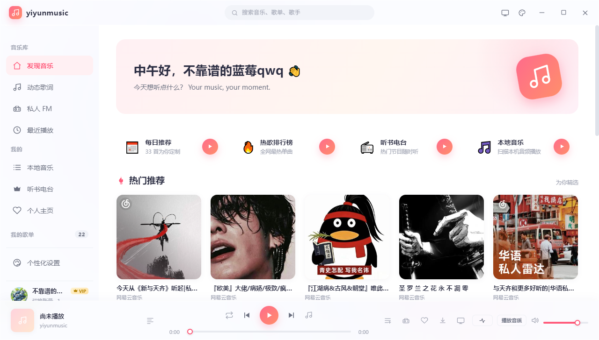

# yiyunmusic · 把动态歌词做到极致的网易云第三方客户端

[简体中文](README.md) | [English](README.en.md) · [更新日志](CHANGELOG.md)

> **一句话**：一个专注于「动态歌词」的网易云音乐第三方桌面客户端 —— 逐字卡拉OK扫光、桌面歌词悬浮窗、15 种可视化形状，其余一切从简。



## 为什么做这个项目

先说清楚：**官方客户端本身就有桌面歌词、逐字歌词、歌词翻译、歌词搜歌，也有频谱可视化**。这些不是我们"从无到有"做出来的。

另外还有一点值得说明：官方近两年在可视化上投入很多，推出了「音波系列」频谱特效、「琉璃光波」播放器等动态效果。所以在"看得见音乐"这件事上，官方并不缺席。

那为什么还要做这个客户端？因为方向不同。官方是**一个大而全的音乐社区**：听歌只是其中一环，旁边还有乐评、直播、商城、会员弹窗。我们想做一个**只围着"听歌 + 看歌词 + 看可视化"转的小客户端**：

- 歌词和可视化是主角，不是播放页角落里的一个开关
- 可视化给到 **15 种可切换形状**和灵敏度调节，而不是一套固定的官方特效
- 没有社交、直播、短视频、商城，只有能安安静静听歌的界面

一句话：**同样的事官方也能做，我们做的是把它做深、做轻、做到你眼前。**

## 和官方客户端比，差在哪

> 只列真实差异。官方已经有的功能，就写"有"，不拿来做卖点。

| 能力 | 网易云官方 | yiyunmusic |
|---|---|---|
| 逐字歌词 | 有（依歌曲是否提供逐字文件） | 有；无逐字文件时按行进度平滑推算，尽量让每首歌都能逐字点亮 |
| 桌面歌词 | 有，可设字体 / 字号 / 颜色 / 卡拉OK高亮 / 锁定 | 有，可拖动、毛玻璃 + 模糊封面背景、宽窄自动切 1/2/3 行、锁鼠标穿透 |
| 歌词翻译 | 有 | 有，双语对照随播放同步 |
| 歌词搜歌 | 有（搜索结果里切「歌词」分类） | 有，同样支持按歌词片段找歌 |
| 音乐可视化 | 有，以内置播放器特效为主（音波系列 / 琉璃光波 / 神光模式） | **15 种可切换形状**：频谱柱 / 镜像 / 圆环 / 螺旋 / 立方体 / 星球 / 隧道 / 曼陀罗 / 星域 / 地形 / 万花筒 / 轨道 / 波形等；灵敏度可调、支持 10 段 EQ 与沉浸全屏 |
| 本地歌词 / 封面识别 | 本地音乐可匹配在线歌词 | 自动读同目录同名 `.lrc`（GBK / UTF-8）与封面图，离线文件也能配齐 |
| Linux 版 | 有（官方 Linux 客户端，deb 为主） | 有，AppImage / deb / tar.gz 三种，Windows 与 Linux 同一发布页 |
| 社交 / 直播 / 短视频 / 商城 | 有 | 无（刻意不做） |
| 广告 / 会员弹窗 | 有 | 无 |

## 歌词长什么样

**动态歌词页** —— 当前行放大、逐字扫光、上下行渐隐、翻译歌词：


**桌面歌词** —— 独立悬浮窗，半透明毛玻璃 + 模糊封面背景，逐字扫光，可拖动、锁鼠标穿透：


## 我们的减法

把精力花在歌词上，意味着明确「不做」这些事：

- ❌ 不做社交、直播、短视频、商城
- ❌ 不做花哨的主题皮肤堆料（只保留明亮 / 暗夜 / 米提亚三套）
- ❌ 克制地做下载、电台等与「听歌 + 看歌词 + 看可视化」无关的附加功能

少即是多。留下的每个功能，都服务于「更好地听歌、看歌词、看可视化」。

## 功能

### 歌词（主角）

- **动态歌词**：网易云经典样式 —— 当前行放大、逐字卡拉OK扫光、上下行渐隐、翻译歌词；歌曲带逐字时间轴（klyric）时按字精准点亮，否则按行进度平滑推算
- **桌面歌词**：独立悬浮窗，半透明毛玻璃 + 模糊封面背景，逐字扫光；可拖动、调字号、换颜色、锁鼠标穿透；窗口宽窄自动切换 1 / 2 / 3 行
- **歌词搜歌**：输入一句歌词，找到对应歌曲
- **本地歌词识别**：自动识别同目录同名 `.lrc` 歌词（支持 GBK 编码）和封面图

### 可视化（主角）

- **15 种形状**：频谱柱、镜像频谱、圆环、脉冲环、螺旋、立方体、星球、点阵、隧道、曼陀罗、星域、地形、万花筒、轨道、波形
- **实时音频驱动**：基于 Web Audio 的频谱与波形分析，低频加权、对数取样，轻微音量也能看清律动
- **可调灵敏度 + 10 段均衡器**：灵敏度 0.5x ~ 4x 自由调，展开面板实时调节各频段增益
- **沉浸全屏**：可视化全屏时只留歌名与画面，页面不可见时停绘、暂停时降帧，省资源

### 听歌（基本功）

- 扫码登录，同步你的歌单、收藏、会员权益；登录态本地保存，下次启动免登录
- 六档音质（标准 ~ 母带），会员账号可完整播放会员歌曲
- 全局搜索、歌单管理、收藏（同步「我喜欢的音乐」）、多账号切换、私人 FM
- 本地音频直接播放（mp3 / flac / wav / m4a / ape / ogg 等）

### 在线收音机（v2.1.0 新增）

- **全球网络电台**：Radio Browser 免费开源数据源，无需 API key；热门 / 按国家 / 按风格 / 搜索四种找台方式
- **实时转文字**：sherpa-onnx + SenseVoice 本地离线识别（中英日韩粤），把电台语音像歌词一样显示；全程不联网、不上传音频
- 模型约 230MB：安装时询问是否下载，或在设置里从多镜像下载（支持断点续传）

### 外观（够用就好）

- 明亮 / 暗夜 / 米提亚三套主题
- **三种 UI 布局**：经典 / 沉浸 / 杂志，设置里一键切换
- 自定义背景图、主题色、侧边栏折叠

## 下载

Windows 和 Linux 现在放在**同一个发布页**，进去按系统挑就行：[v2.1.3 Release](https://github.com/lanmeiawa/yiyunmusic/releases/tag/v2.1.3)。

### Windows（10 / 11 x64）

- **yiyunmusic-Setup-2.1.3.exe** —— 安装版（可自定义安装目录、自动创建快捷方式）
- **yiyunmusic-portable-2.1.3.exe** —— 便携版，免安装，双击即用

> 安装新版时会自动迁移旧版的登录态与个性化设置，无需重新扫码登录。登录凭证（Cookie）已加密存储，不再明文落盘。

### Linux（x64）

- **yiyunmusic-2.1.3-x86_64.AppImage** —— Arch / 通用，`chmod +x` 后双击即可运行
- **yiyunmusic-2.1.3-amd64.deb** —— Ubuntu / Debian，`sudo apt install ./yiyunmusic-2.1.3-amd64.deb`
- **yiyunmusic-2.1.3-x64.tar.gz** —— 通用便携版，解压后运行 `./yiyunmusic`

## 使用方法

1. 首次启动确认免责声明
2. 用网易云音乐 App 扫码登录
3. 点击歌单 / 双击歌曲即可播放
4. 点播放条右侧的歌词按钮（或左侧「动态歌词」）进入歌词页
5. 点标题栏的显示器图标开启桌面歌词

## 免责声明

本项目是**第三方**客户端，非网易云官方产品，依赖网易云的非公开接口，接口可能随官方调整而变化。请尊重音乐版权、支持正版；本项目仅供个人学习与研究使用，请勿用于商业用途或大规模分发。

## 开发

```bash
npm install
npm run dev        # 开发环境
npm run dist       # 打包：NSIS 安装包 + 便携版 exe
```

技术栈：Electron 33 · React 18 · Vite 5 · TypeScript · NeteaseCloudMusicApi
