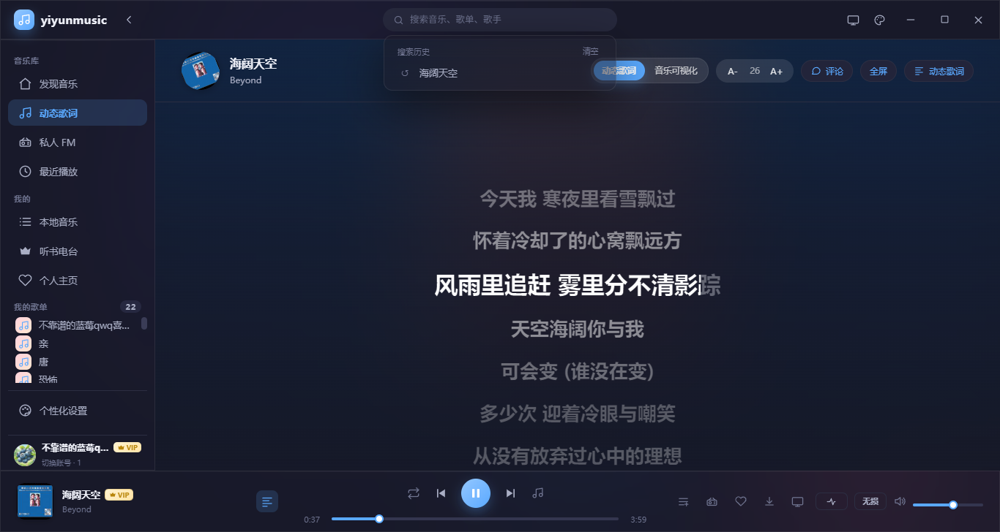

# yiyunmusic · 把动态歌词做到极致的网易云第三方客户端

[简体中文](README.md) | [English](README.en.md)

> **一句话**：一个专注于「动态歌词」的网易云音乐第三方桌面客户端 —— 逐字卡拉OK扫光、桌面歌词悬浮窗、歌词搜歌，其余一切从简。


## 为什么做这个项目

官方客户端没有桌面歌词，软件里的歌词也只是「整行变色」，不会逐字点亮。市面上的第三方客户端大多在堆下载、堆皮肤、堆各种花哨功能，歌词体验却一直是短板。

我们反过来：**把歌词做成主角**。你听歌时盯着的每一句、每一个字，都要跟着歌声精准点亮。其余功能能做就做，做不好就砍。

## 和官方客户端比，好在哪

| 能力 | 网易云官方 | yiyunmusic |
|---|---|---|
| 逐字卡拉OK歌词 | 仅部分歌曲 | 全量歌曲，逐字精准扫光 |
| 桌面歌词 | 无 | 独立悬浮窗，毛玻璃 + 逐字扫光 + 鼠标穿透 |
| 歌词翻译 | 部分歌曲 | 双语对照，随播放同步 |
| 歌词搜歌 | 无 | 输入一句歌词，找到这首歌 |
| 本地歌词识别 | 无 | 自动识别同名 `.lrc`（GBK / UTF-8）和封面图 |
| 广告 / 会员弹窗 | 有 | 无 |
| 社交 / 直播 / 短视频 | 有 | 无 |

## 歌词长什么样

**动态歌词页** —— 当前行放大、逐字扫光、上下行渐隐、翻译歌词：



**桌面歌词** —— 独立悬浮窗，半透明毛玻璃 + 模糊封面背景，逐字扫光，可拖动、锁鼠标穿透：


## 我们的减法

把精力花在歌词上，意味着明确「不做」这些事：

- ❌ 不做社交、直播、短视频、商城
- ❌ 不做花哨的主题皮肤堆料（只保留清爽的明亮 / 暗夜）
- ❌ 克制地做下载、电台等与「听歌 + 歌词」无关的附加功能

少即是多。留下的每个功能，都服务于「更好地听歌、看歌词」。

## 功能

### 歌词（主角）

- **动态歌词**：网易云经典样式 —— 当前行放大、逐字卡拉OK扫光、上下行渐隐、翻译歌词；歌曲带逐字时间轴（klyric）时按字精准点亮，否则按行进度平滑推算
- **桌面歌词**：独立悬浮窗，半透明毛玻璃 + 模糊封面背景，逐字扫光；可拖动、调字号、换颜色、锁鼠标穿透；窗口宽窄自动切换 1 / 2 / 3 行
- **歌词搜歌**：输入一句歌词，找到对应歌曲
- **本地歌词识别**：自动识别同目录同名 `.lrc` 歌词（支持 GBK 编码）和封面图

### 听歌（基本功）

- 扫码登录，同步你的歌单、收藏、会员权益；登录态本地保存，下次启动免登录
- 六档音质（标准 ~ 母带），会员账号可完整播放会员歌曲
- 全局搜索、歌单管理、收藏（同步「我喜欢的音乐」）、多账号切换、私人 FM
- 本地音频直接播放（mp3 / flac / wav / m4a / ape / ogg 等）

### 外观（够用就好）

- 明亮 / 暗夜两套主题
- 自定义背景图、主题色、侧边栏折叠

## 下载

前往 [Releases](https://github.com/lanmeiawa/yiyunmusic/releases) 下载最新版（Windows 10 / 11 x64）：

- **yiyunmusic-Setup-2.0.2.exe** —— 安装版（可自定义安装目录、自动创建快捷方式）
- **yiyunmusic-portable-2.0.2.exe** —— 便携版，免安装，双击即用

> 安装新版时会自动迁移旧版的登录态与个性化设置，无需重新扫码登录。

## 使用方法

1. 首次启动确认免责声明
2. 用网易云音乐 App 扫码登录
3. 点击歌单 / 双击歌曲即可播放
4. 点播放条右侧的歌词按钮（或左侧「动态歌词」）进入歌词页
5. 点标题栏的显示器图标开启桌面歌词

## 免责声明

本项目是**第三方**客户端，非网易云官方产品，依赖网易云的非公开接口，接口可能随官方调整而变化。请尊重音乐版权、支持正版；本项目仅供个人学习与研究使用，请勿用于商业用途或大规模分发。

## 开发

```bash
npm install
npm run dev        # 开发环境
npm run dist       # 打包：NSIS 安装包 + 便携版 exe
```

技术栈：Electron 33 · React 18 · Vite 5 · TypeScript · NeteaseCloudMusicApi
